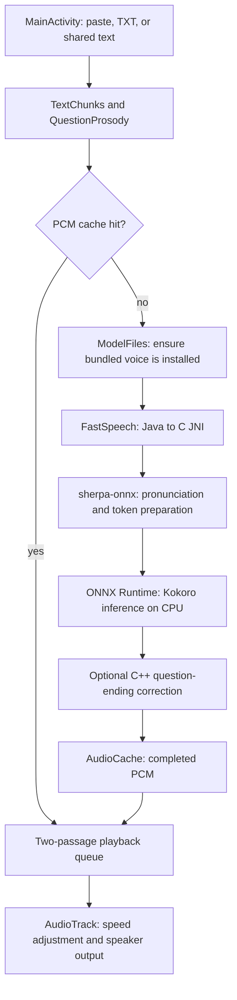

# Application architecture

Ember Reader is a single-screen Android text reader. Its design prioritizes a consistent English voice, a short route from text to playback, and predictable local resource use. The screen contains a text editor, a file-open action, a speed slider, playback controls, and progress/status information. It exposes one voice rather than asking the reader to configure speech models.

The model choice follows that scope: a compact Kokoro inference bundle supplies learned speech prosody through the native CPU runtime, while the app owns passage scheduling and question-ending correction. The [model-selection rationale](MODEL.md#why-kokoro-is-used-here) explains the tradeoffs against other local engines and instruction-controlled speech models, including the limits of the available evidence.

## From text to sound

The Java controller schedules each passage. The native runtime converts its text to phoneme tokens and runs the neural network. After optional pitch processing, the app queues complete mono PCM passages for playback. The [model guide](MODEL.md) describes the network inside the inference step.

## Component responsibilities

Paths below are relative to the repository root. Java classes live in `app/src/main/java/com/ember/reader/`.

| Component | Responsibility |
| --- | --- |
| `MainActivity.java` | Text entry, Android file/share intents, controls, status rendering, saved text/speed, and foreground lifecycle |
| `ReaderApplication.java` | Owns one controller for the application process; requests idle resource release under memory pressure |
| `ReaderController.java` | Coordinates setup, cache lookup, synthesis, cancellation, audio focus, queueing, and playback |
| `TextChunks.java` | Validates input and creates passages of at most 260 UTF-16 code units, keeping surrogate pairs intact |
| `QuestionProsody.java` | Flags auxiliary-led and tag questions ending in `?`; excludes wh-questions and explicit alternatives |
| `ModelFiles.java` | Installs the bundled voice into private storage and validates its manifest |
| `FastSpeech.java` | Owns the native engine handle and exposes load/generate/cancel/close operations |
| `AudioCache.java` | Keeps completed immutable audio arrays in a bounded worker-owned LRU cache |
| `app/src/main/cpp/fast_jni.c` | Converts Java strings to standard UTF-8, configures sherpa, checks generated audio, and bridges native cancellation |
| `app/src/main/cpp/question_prosody.cpp` | Estimates pitch and modifies flagged question endings using Signalsmith DSP |

## Work scheduling and playback

The main Android thread handles UI events and rendering. One worker executor serializes model installation, model ownership, cache access, and synthesis; it avoids competing inference requests. A separate playback executor consumes a queue with capacity for two completed passages. The queue bounds how far synthesis can run ahead of playback, though it does not include the passage currently being synthesized or played.

The first sentence is scheduled separately. Later plain sentences may be grouped up to the passage limit. A recognized question is isolated so its flag applies to the correct ending; only the last fragment of a long split question is flagged.

JNI synthesis returns a complete `float[]` per passage. The runtime's progress callback is used for cancellation, not incremental audio playback. `AudioTrack` accepts 24 kHz mono floating-point PCM and writes it in smaller blocks. Speed is applied during playback with pitch set to 1.0; synthesis always uses speed 1.0. Changing the speed therefore permits reuse of cached PCM.

Pause suspends playback; generation may continue until the queue fills. Stop sets Java/native cancellation flags and flushes playback. Native cancellation is observed at runtime callback boundaries, so an in-flight operation may take time to return. Audio focus loss also stops the job. `MainActivity.onPause()` stops reading, and there is no background playback service.

## Model and audio lifecycle

The APK carries `assets/fast-voice.zip` and `assets/fast-model-manifest.json`. On first use, `ModelFiles` extracts files into a staging directory, accepts only manifest-listed paths, checks size and SHA-256 for every file, and installs the completed directory as `files/fast-model`. A verified revision marker records successful setup. Subsequent installation checks compare the marker, file presence, and file sizes; they do not hash every file again on every read.

The native model is loaded lazily for uncached work. A process-owned controller reuses it across activity instances. If every requested passage is already cached, the job skips model setup/loading and inference. Idle memory pressure can release both the model and cached audio; Android process termination also discards them.

The LRU cache is bounded to 2,880,000 samples and 64 entries: at 24 kHz, approximately two minutes of audio and 11.5 MB of sample storage, plus object overhead. Keys include the passage text and its rising-question flag. The cache stores final processed PCM and is not persisted to disk.

## Where expression comes from

Kokoro predicts pronunciation timing and speech prosody from phonemes and a fixed voice embedding. Ember adds a separate deterministic rule for some yes/no questions. This rule is audio postprocessing, outside the neural network; it neither retrains the model nor changes its weights.

For a flagged question with reliable voicing, the processor analyzes the final phrase and targets a rising contour over up to 0.4 seconds of its ending. The target is 4–5.5 semitones depending on starting pitch, with local correction bounded to -3/+12 semitones. Formant compensation aims to retain vocal character; sample count stays unchanged. Already clear rises and unreliable/unvoiced clips can bypass the correction. Audio before the correction's entry region stays unchanged. These numerical rules do not guarantee naturalness or semantic emotion recognition.

## Data and privacy

Text and playback speed use app-private preferences. Voice files use app-private internal storage. Generated audio is retained only in memory and sent to Android audio output. The manifest declares no permissions and disables Android app backup. Opening a document uses the system picker and access to the selected URI; no broad storage permission is requested. The app has no cloud endpoint, account, telemetry client, microphone input, or audio export feature.

## Developer entry points

- **Screen and controls:** `MainActivity.java` and `app/src/main/res/layout/activity_main.xml`.
- **Input boundaries and question recognition:** `TextChunks.java` and `QuestionProsody.java`, with corresponding JVM tests in `app/src/test/`.
- **Voice selection or inference configuration:** `FastSpeech.java` and `fast_jni.c`. The adapter currently requires 24 kHz and exactly 11 bundled speakers; the UI selects speaker 0.
- **Intonation processing:** `question_prosody.cpp`. Its pitch range and target contour are tuned for the selected female voice. A voice change requires listening and pitch-analysis checks.
- **Model/dependency updates:** `scripts/prepare_fast_voice.py` and `scripts/prepare_prosody.py`. Update compatible artifacts, hash pins, the manifest, native guards, notices, and validation together. Replacing only an ONNX file is insufficient.

See [VALIDATION.md](../VALIDATION.md) for current test coverage and device acceptance checks.
