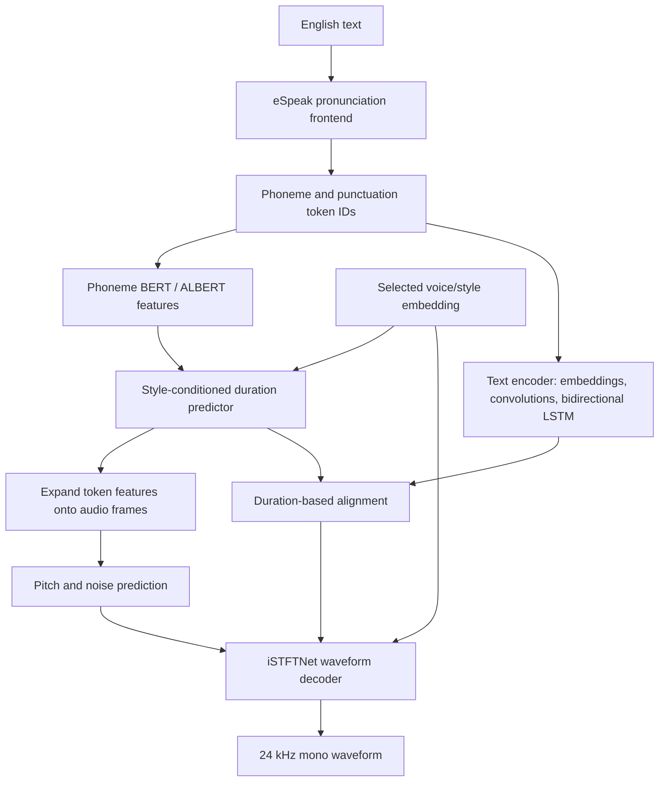

# Speech model and model files

Ember Reader uses **Kokoro-82M, English v0.19, in sherpa-onnx's INT8 ONNX distribution**. It runs on the phone's CPU through sherpa-onnx 1.12.36 and ONNX Runtime 1.23.2. The app selects US English female speaker **0 (`af`)**; the bundle contains eleven speaker embeddings. See the [sherpa v0.19 model description and voice mapping](https://k2-fsa.github.io/sherpa/onnx/tts/pretrained_models/kokoro.html#kokoro-en-v0-19-english-11-speakers).

## Why Kokoro is used here

The selection prioritizes **natural English reading on a phone's CPU, local execution, distributable weights, and a manageable application size**. A consistent voice and practical reading performance take precedence over voice variety and instruction-driven acting. Kokoro is the chosen baseline for those requirements; the project has not established that it is the best available model on every device or for every passage.

| Requirement | Why this implementation fits |
| --- | --- |
| Read without a service | The model, voice embeddings, and pronunciation data ship with the APK. Synthesis needs no server, account, or recurring synthesis API fee. |
| Keep the deployment manageable | The 82-million-parameter model has a prepared INT8 graph of about 134 MB and a complete extracted voice bundle of about 158 MB. These are known packaging costs; peak RAM and generation speed still require device measurements. |
| Produce learned speech prosody | The network predicts sound durations, pitch, and waveform details. This supplies the basis for natural reading without a separate emotion classifier or an instruction-following language model. It does not guarantee convincing emotion or question intonation. |
| Integrate with Java Android code | The available ONNX conversion works with this app's sherpa C API/JNI path and ARM64 CPU runtime. The phone needs neither Python nor a GPU-specific inference stack. |
| Support inspection and redistribution | Apache-licensed model weights and public inference/model definitions provide a documented provenance. The combined application's dependency licenses remain separate obligations; see [third-party notices](../THIRD_PARTY_NOTICES.md). |
| Serve a focused reading interface | The English bundle provides a usable fixed voice and pronunciation frontend. The app can concentrate on text preparation, buffering, and playback instead of model or voice selection. |

The model size and license are documented in the [Kokoro model card](https://huggingface.co/hexgrad/Kokoro-82M); the available conversion and speaker mapping are documented by [sherpa-onnx](https://k2-fsa.github.io/sherpa/onnx/tts/pretrained_models/kokoro.html#kokoro-en-v0-19-english-11-speakers). The suitability judgment above follows from this app's constraints and implementation, rather than an independent quality ranking.

### Alternatives and tradeoffs

| Candidate | When it could be a better fit | Why it is not the current default |
| --- | --- | --- |
| [Piper](https://github.com/OHF-Voice/piper1-gpl) | A local neural engine worth testing when a particular voice or a tighter resource budget is the priority. Its project provides a native C/C++ API. | No controlled phone comparison of selected Piper voices against this Kokoro voice has been completed. There is no evidence here that Piper universally sounds worse or that Kokoro universally runs faster. |
| [Qwen3-TTS 1.7B CustomVoice](https://huggingface.co/Qwen/Qwen3-TTS-12Hz-1.7B-CustomVoice) | Natural-language instructions for speaking style and emotional expression are central requirements. | Its much larger parameter budget and different runtime make it a different deployment choice. This reader prioritizes one local English voice over that control. Parameter counts alone do not predict latency, RAM, or listening quality. |
| [Newer Kokoro releases](https://huggingface.co/hexgrad/Kokoro-82M#releases) | A candidate voice or release demonstrates better pronunciation, intonation, or device performance. | The app currently validates a pinned v0.19 conversion. A newer release needs integration checks and matched device/listening tests before replacing it. |

### Why pin v0.19?

The specific version is an integration baseline: its eleven-speaker metadata, 24 kHz output, phonemizer data, integrity manifest, and native adapter are already exercised by this project. Pinning the archive and runtime makes the shipped assets identifiable and rebuildable. This is a compatibility and verification reason, **not evidence that v0.19 has the best speech quality**. Upstream publishes newer releases; there is no completed comparison here that justifies ranking v0.19 above them.

### Evidence needed to call a model the best fit

[Validation](../VALIDATION.md) records working desktop inference and automated checks, but phone listening acceptance remains pending. A defensible selection should compare candidate voices on the same target phones and English passages: first-audio delay, generation time relative to audio duration, peak RAM, sustained heat/battery impact, pronunciation, question intonation, and listener preference. Include cold starts, warm reads, short sentences, and long passages; caching should be reported separately from synthesis.

Revisit the choice if those tests favor another model, if target phones cannot sustain reading, or if strong instruction-controlled emotion becomes essential. Kokoro's current role is a compact local reading engine with a specific question-ending adjustment, rather than a general expressive narration system.

## What `.models` contains

`.models/fast` is a development copy of the current inference assets. Its name is a build-directory label. The preparation script packages these files into the APK; the phone does not read this workstation directory.

| File or directory | Purpose |
| --- | --- |
| `.models/fast/model.int8.onnx` | Exported neural computation graph and trained parameters; 134,186,977 bytes |
| `.models/fast/voices.bin` | Precomputed voice/style embeddings; 5,755,904 bytes |
| `.models/fast/tokens.txt` | Mapping from pronunciation symbols to integer token IDs |
| `.models/fast/espeak-ng-data/` | Language/pronunciation data used by the native phonemizer |
| `.models/fast/LICENSE` | License text distributed with the model archive; dependency notices also apply |
| `.models/fast/README.md` | Short upstream pointer supplied by the archive |

The current extracted bundle has 360 files totaling **157,947,103 bytes**. Its APK asset ZIP is **102,643,830 bytes**. These are file sizes, not a measurement of peak runtime RAM.

`.models` is ignored by Git. `scripts/prepare_fast_voice.py` recreates `.models/fast` from a hash-pinned upstream archive. Keep project documentation here in `docs/`; files added inside `.models/fast` would be included when that script rebuilds the voice ZIP and manifest.

Only the current Kokoro assets are retained in this directory. See the [workspace storage guide](STORAGE.md) for which generated files are required for reading, building, and optional desktop audio checks.

## Weights, source code, and training

The ONNX file contains the operations and learned numerical parameters needed for inference. It can be inspected as a graph and executed by a compatible runtime. Python source describes those operations in editable classes and functions; training code describes how parameters are learned from data. A directory containing weights is not, by itself, a complete training project.

Kokoro is described upstream as an **open-weight model with about 82 million parameters**, with Apache-licensed weights and a StyleTTS 2 / iSTFTNet architecture. Its public release does not include the full StyleTTS 2 diffusion/style-encoder training system. See the [upstream model facts](https://huggingface.co/hexgrad/Kokoro-82M#model-facts).

For the version used here, the author's [v0.19 archive](https://huggingface.co/hexgrad/kLegacy/tree/main/v0.19) contains Python inference/model files and the original checkpoint. The current model card and current Python package also discuss newer releases; follow the **v0.19** files when investigating this app. Ember's workspace supplies the converted inference assets, not that full Python project, a training pipeline, or its training data. Rebuilding the APK uses the pinned pretrained conversion; it does not train a model.

## How Kokoro produces speech

The following describes the v0.19 inference path. The Java application delegates it to the native runtime; it does not implement these neural layers in Java.

The pronunciation frontend produces speech sounds and punctuation tokens. The network estimates how long each sound lasts, aligns token features to audio frames, and predicts pitch (`F0`) and a noise-related signal. A stored 256-value style vector is split between prosody and acoustic decoding. The decoder combines these signals into a waveform. This is the ordering shown by the author's [v0.19 inference implementation](https://huggingface.co/hexgrad/kLegacy/blob/main/v0.19/kokoro.py).

The text encoder uses learned embeddings, convolutional layers, and a bidirectional LSTM. The prosody predictor uses recurrent and style-conditioned layers. These are visible in the [v0.19 model definitions](https://huggingface.co/hexgrad/kLegacy/blob/main/v0.19/models.py). The [iSTFTNet decoder implementation](https://huggingface.co/hexgrad/kLegacy/blob/main/v0.19/istftnet.py) supplies the waveform synthesis stage, including inverse short-time Fourier reconstruction. The diagram summarizes component roles rather than every layer or exported ONNX node.

## Interface used by the native runtime

The [pinned v0.19 quantization script](https://github.com/k2-fsa/sherpa-onnx/blob/90f3020f2fb723e5990449c276f74b34a23bc3c2/scripts/kokoro/v0.19/dynamic_quantization.py) documents this graph interface:

| Tensor | Type and shape | Meaning |
| --- | --- | --- |
| `tokens` | int64, `[1, token_count]` | Encoded phonemes/punctuation with boundary tokens |
| `style` | float32, `[1, 256]` | Selected voice/style vector |
| `speed` | float32, `[1]` | Synthesis speed; Ember passes 1.0 |
| `audio` | float32, `[sample_count]` | Generated waveform |

Sherpa selects the style vector from `voices.bin` using speaker ID and token length, then executes the graph through ONNX Runtime. See its [pinned Kokoro model adapter](https://github.com/k2-fsa/sherpa-onnx/blob/90f3020f2fb723e5990449c276f74b34a23bc3c2/sherpa-onnx/csrc/offline-tts-kokoro-model.cc). A voice embedding is a numeric conditioning vector, not a set of prerecorded sentences and not a free-form emotion instruction.

INT8 here refers to dynamic quantization of supported model operations. It reduces the deployed model's storage and changes its numerical representation; it does not mean every tensor or operation uses eight-bit integers. The inference interface still includes floating-point style, speed, and output audio. The app does not use a GPU/NPU execution provider or run training.

## Model delivery and provenance

The preparation script obtains the sherpa archive, verifies its SHA-256, extracts assets, writes a per-file manifest, and creates `app/src/main/assets/fast-voice.zip`. On the phone, first-use setup checks the files and installs them under private `files/fast-model`. Subsequent reads reuse the installed files. See [application architecture](ARCHITECTURE.md) for loading and caching.

| Pin | Value |
| --- | --- |
| Model archive | `kokoro-int8-en-v0_19.tar.bz2` |
| Archive SHA-256 | `c9f0dd393615805b0bab050c340834d5e684e732aec91c0e860cd30e982c08bd` |
| Runtime | sherpa-onnx 1.12.36 |
| Runtime source revision | `90f3020f2fb723e5990449c276f74b34a23bc3c2` |
| Android runtime archive SHA-256 | `c8a03a8947406558063e302f5d763f0a7d101ec88d436cc678840590460740ab` |

The URLs and pins live in [prepare_fast_voice.py](../scripts/prepare_fast_voice.py). The app's Java/native source lives in `app/src/main/`; upstream runtime source access is described in [SOURCE.txt](../dist/SOURCE.txt). See [THIRD_PARTY_NOTICES.md](../THIRD_PARTY_NOTICES.md) for component licenses. The question-ending adjustment is separate application DSP, described in [application architecture](ARCHITECTURE.md); it does not modify the Kokoro architecture or weights.
